# Preferences Reference

This page lists every option in the Marva Preferences dialog, grouped the way the dialog groups them, with a short description of what each one does. Most options include a short animation showing the option being changed (top) and the effect in Marva (bottom).

## Opening Preferences

Click **Preferences** in the Nav Bar at the top of Marva, then click **Preferences** at the top of the menu that opens. The Preferences dialog appears over the edit screen.

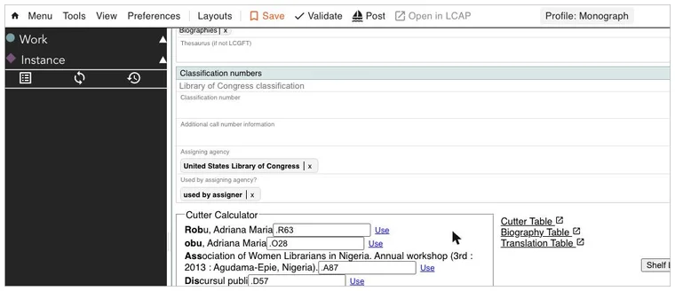

In the dialog, use the drop-down at the top to switch between option groups, or type in the search box to search every option by its label or description. The dialog can be dragged by its title bar and resized from its bottom-right corner, so you can move it out of the way to see the effect of a change. Changes take effect immediately; there is no save button.

**Color options** open a color picker when clicked. The small icon next to a color option's description lets you type a color value directly (hex6 or hex8, for example `#ff0000`). **Slider options** show the current value to the left of the slider. **Checkbox options** are on when checked.

## The Preferences menu

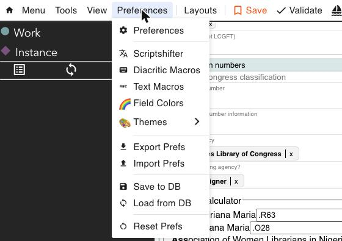

Besides opening the dialog, the Preferences menu holds a few tools of its own:

- **Scriptshifter**, **Diacritic Macros** and **Text Macros** open their own dialogs. See [Appendix C: ScriptShifter](c-scriptshifter.md).
- **Field Colors** opens the Field Colors dialog, where you set a background color for mandatory fields, for all fields, for all Work or all Instance fields, or for individual components. Each has a *Default Color* and a *Data Changed Color* used once the field has a value. The undo icon beside a color returns it to the default.
- **Themes** switches the whole Marva skin between *Default* (white background), *Dark* (black background, white text) and *Gray* (gray background, black text).
- **Export Prefs** saves all of your preferences to a `.json` file that can be kept locally or shared with other Marva users. **Import Prefs** loads such a file; the dialog that opens lets you choose which parts to import (styling, ScriptShifter settings, text and diacritic macros, custom layouts, component library).
- **Save to DB** stores your preferences in Marva's database under your login, and **Load from DB** restores them, so the same preferences can be used from another computer or browser without managing files.
- **Reset Prefs** returns every preference to the Marva default.

Preferences are kept in the browser, so make sure Chrome is allowed to save site data (`chrome://settings/content/siteData`, *Allow sites to save data on your device*). If a customization does not seem to apply, a hard refresh (Ctrl+Shift+R) usually fixes it. An imported component library only appears after a hard refresh.

## Contents

- [Opening Preferences](#opening-preferences)
- [The Preferences menu](#the-preferences-menu)
- [Edit Panel](#edit-panel)
  - [Edit panel width](#edit-panel-width)
  - [No Scrollbar](#no-scrollbar)
  - [Work Background Color](#work-background-color)
  - [Instance Background Color](#instance-background-color)
  - [Item Background Color](#item-background-color)
  - [Secondary Instance Background Color](#secondary-instance-background-color)
  - [Component Label Color](#component-label-color)
  - [Field Focus Background Color](#field-focus-background-color)
  - [Field Background Color](#field-background-color)
  - [Field Border Color](#field-border-color)
  - [Display field labels](#display-field-labels)
  - [Field Label font size](#field-label-font-size)
  - [Field Label color](#field-label-color)
  - [Bold Field Labels](#bold-field-labels)
  - [Quick Add/Delete](#quick-adddelete)
  - [BF display tags](#bf-display-tags)
  - [Properties adhoc](#properties-adhoc)
  - [Resource switch button](#resource-switch-button)
  - [Horizontal Edit Panel scroll](#horizontal-edit-panel-scroll)
  - [Scrollbar Track Color](#scrollbar-track-color)
  - [Scrollbar Thumb Color](#scrollbar-thumb-color)
  - [Hide non-LC Subjects](#hide-non-lc-subjects)
  - [Hide non-LC class numbers](#hide-non-lc-class-numbers)
  - [Spellcheck](#spellcheck)
  - [Compact View](#compact-view)
  - [Compact Min Width](#compact-min-width)
  - [Placeholder Font Color](#placeholder-font-color)
- [Sidebars - Property](#sidebars---property)
  - [Background Color](#background-color)
  - [Highlight Color](#highlight-color)
  - [Sidebar width](#sidebar-width)
  - [Font Size](#font-size)
  - [Font](#font)
  - [Text Color](#text-color)
  - [Empty indicator color](#empty-indicator-color)
  - [Populated indicator color](#populated-indicator-color)
  - [No Scrollbar](#no-scrollbar-1)
  - [Type Labels](#type-labels)
  - [Number Labels](#number-labels)
  - [Accordion List](#accordion-list)
  - [Component Library](#component-library)
  - [Prompt to add Library Component](#prompt-to-add-library-component)
  - [Resize Line Color](#resize-line-color)
  - [Resize Line Border Color](#resize-line-border-color)
  - [Default Component Library](#default-component-library)
  - [Edit Component Library Defaults](#edit-component-library-defaults)
- [Sidebars - Previews](#sidebars---previews)
  - [Background Color](#background-color-1)
  - [Highlight Color](#highlight-color-1)
  - [Sidebar width](#sidebar-width-1)
  - [Font Size](#font-size-1)
  - [Font](#font-1)
  - [Text Color](#text-color-1)
  - [MARC Boldness](#marc-boldness)
  - [MARC Font](#marc-font)
  - [No Scrollbar](#no-scrollbar-2)
  - [MARC HTML](#marc-html)
  - [Subfield Highlight Color](#subfield-highlight-color)
- [Nav Bar](#nav-bar)
  - [Height](#height)
  - [Font Size](#font-size-2)
  - [Background Color](#background-color-2)
  - [Text Color](#text-color-2)
- [Literal Field](#literal-field)
  - [Font Size](#font-size-3)
  - [Font Size Script](#font-size-script)
  - [Font Color](#font-color)
  - [Lang Label Background Color](#lang-label-background-color)
  - [Lang Label Font Color](#lang-label-font-color)
  - [Lang Label Font Size](#lang-label-font-size)
  - [Make literals bold](#make-literals-bold)
  - [Paired literals, show non-Latin First](#paired-literals-show-non-latin-first)
  - [Display a line between the two paired literals](#display-a-line-between-the-two-paired-literals)
  - [Paired literal line color](#paired-literal-line-color)
  - [Move components with arrow keys](#move-components-with-arrow-keys)
- [Lookup Field](#lookup-field)
  - [Lookup value background color](#lookup-value-background-color)
  - [Lookup value border color](#lookup-value-border-color)
  - [Lookup value text color](#lookup-value-text-color)
  - [Linked Icon Color](#linked-icon-color)
  - [Simple Lookup Popup Background Color](#simple-lookup-popup-background-color)
  - [Simple Lookup Popup Text Color](#simple-lookup-popup-text-color)
  - [Lookup font size](#lookup-font-size)
  - [Lookup Shortcode Aliases](#lookup-shortcode-aliases)
- [Action Button](#action-button)
  - [Action button icon](#action-button-icon)
  - [Action button color](#action-button-color)
  - [Action Button background color](#action-button-background-color)
  - [Button Icon Size](#button-icon-size)
  - [Button Border Width](#button-border-width)
  - [Action Border Color](#action-border-color)
  - [Button Border Radius](#button-border-radius)
  - [Action btn menu color, Icon Size, Action btn menu Border width, Action btn menu border color, Action btn menu Border radius, Action btn menu font color, Action btn menu highlight color](#action-btn-menu-color-icon-size-action-btn-menu-border-width-action-btn-menu-border-color-action-btn-menu-border-radius-action-btn-menu-font-color-action-btn-menu-highlight-color)
  - [Display Button](#display-button)
  - [Menu background color](#menu-background-color)
  - [Menu Button Color](#menu-button-color)
  - [Menu Border Color](#menu-border-color)
  - [Menu Text Color](#menu-text-color)
  - [Button text size](#button-text-size)
- [Modals](#modals)
  - [Background Color](#background-color-3)
  - [Background Accent Color](#background-accent-color)
  - [Text Color](#text-color-3)
- [Complex Lookup](#complex-lookup)
  - [Use lookup dropdown](#use-lookup-dropdown)
  - [Show icons in value](#show-icons-in-value)
  - [Scroll All Results](#scroll-all-results)
  - [Scroll by Section](#scroll-by-section)
  - [Number of Names](#number-of-names)
  - [Number of Complex Headings](#number-of-complex-headings)
  - [Number of Simple Headings](#number-of-simple-headings)
  - [Number of CYAC Headings](#number-of-cyac-headings)
  - [Include Usage](#include-usage)
  - [Use NAR Advanced Mode by default](#use-nar-advanced-mode-by-default)
  - [Number for Fewer/More Buttons](#number-for-fewermore-buttons)
- [General](#general)
  - [Work icon color](#work-icon-color)
  - [Instance icon color](#instance-icon-color)
  - [Item icon color](#item-icon-color)
  - [Copy mode default](#copy-mode-default)
  - [Ad Hoc Mode](#ad-hoc-mode)
  - [Auto Save Mode](#auto-save-mode)
  - [No field colors in Workflows](#no-field-colors-in-workflows)
  - [Default Load Type "Continue"](#default-load-type-continue)
  - [Load with Default Values](#load-with-default-values)
- [Shelflisting](#shelflisting)
  - [Display cutter tools](#display-cutter-tools)
  - [Cutter Length](#cutter-length)
  - [Shelf List Accent](#shelf-list-accent)
  - [ClassWeb Links Inline](#classweb-links-inline)
  - [Link 1 to Link 8 Label and URL](#link-1-to-link-8-label-and-url)
  - [MLC Division](#mlc-division)
  - [Load with Classification Defaults](#load-with-classification-defaults)
- [Scriptshifter](#scriptshifter)
  - [Capitalize the first letter](#capitalize-the-first-letter)
- [Copy Cat](#copy-cat)
  - [Copy Cat color](#copy-cat-color)
  - [Text Color](#text-color-4)
  - [Results Color](#results-color)
  - [Selected Color](#selected-color)
  - [MARC Hover](#marc-hover)
  - [Existing Color](#existing-color)
  - [New Color](#new-color)
  - [Font Size](#font-size-4)
  - [NonLatin Default](#nonlatin-default)
  - [Priority Default](#priority-default)
- [Other preferences](#other-preferences)

---

## Edit Panel

Options for the Edit Panel, the middle panel where the record is edited.

### Edit panel width

The width of the Edit Panel as a percentage of the window. Default: 50. Range: 5 to 100.

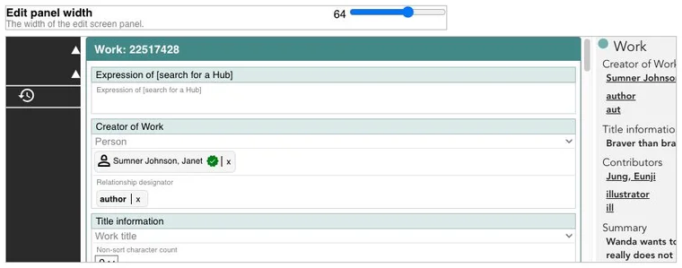

### No Scrollbar

Hides the scroll bar in the Edit Panel. Default: off.

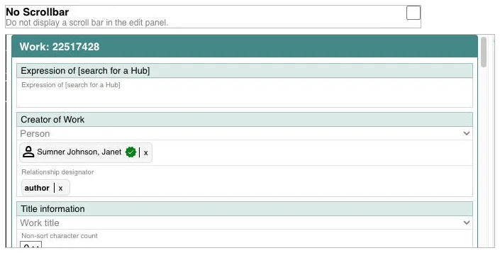

### Work Background Color

The background color of the Work section of the Edit Panel. Default: `#deeaea`.

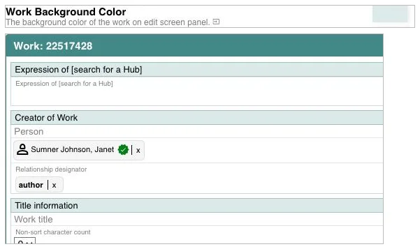

### Instance Background Color

The background color of the Instance section of the Edit Panel. Default: `#ffe2ff96`.

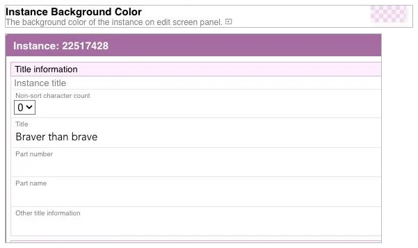

### Item Background Color

The background color of the Item section of the Edit Panel, when a record has Items. Default: `#ffe2ff96`.

### Secondary Instance Background Color

The background color of additional Instances when a record has more than one. Default: `#f671f696`.

### Component Label Color

The color of the component heading text in the Edit Panel, for example *Title information*. Default: black.

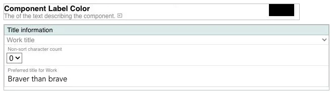

### Field Focus Background Color

The background color of a field while the cursor is in it. Default: `#f2f6f6`.

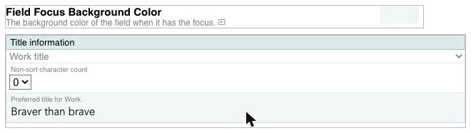

### Field Background Color

The background color of fields that do not have the cursor. Default: transparent.

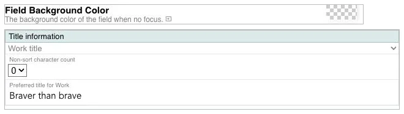

### Field Border Color

The color of the line between fields inside a component. Default: a light transparent gray.

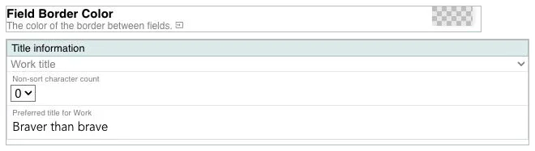

### Display field labels

Shows the small label above each value in a component, for example *Preferred title for Work*. Default: on.

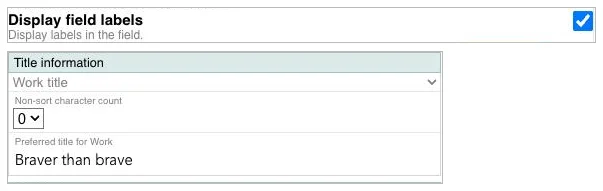

### Field Label font size

The size of the field labels. Default: 0.65. Range: 0 to 1.

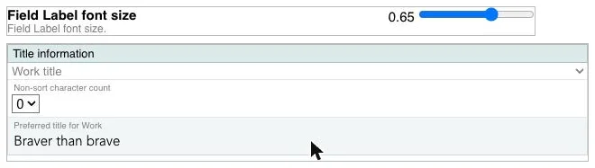

### Field Label color

The color of the field labels. Default: gray.

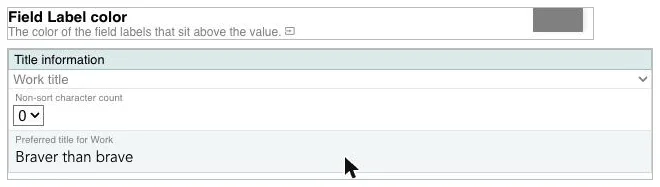

### Bold Field Labels

Makes the field labels bold. Default: off.

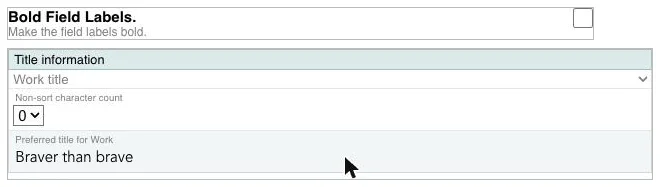

### Quick Add/Delete

Adds **delete** and **add** buttons to each component heading for removing the component or adding another one of the same kind. Default: off.

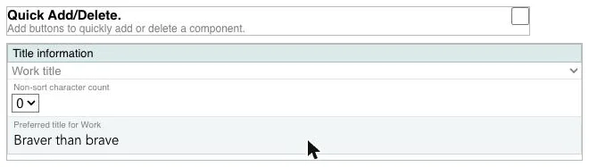

### BF display tags

Shows abbreviated BIBFRAME property names in place of the natural language component and field labels. Default: off.

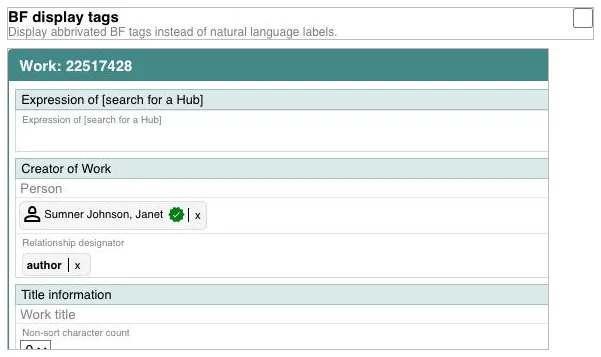

### Properties adhoc

Hides empty components in the Edit Panel and adds a drop-down list for adding components as they are needed. Default: off. See also **Ad Hoc Mode** under General.

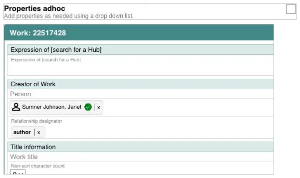

### Resource switch button

Adds a button at the top of the Edit Panel for switching between the Work and the Instance, and shows only one of them at a time. Default: off.

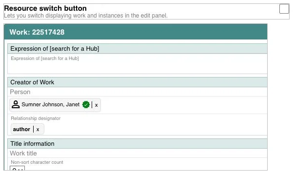

### Horizontal Edit Panel scroll

Stops field values from wrapping to the next line. Long values extend to the right and a horizontal scroll bar appears at the bottom of the Edit Panel. Default: off.

### Scrollbar Track Color

The color of the scroll bar track (the background) in the Edit Panel. Default: `#fafafa`.

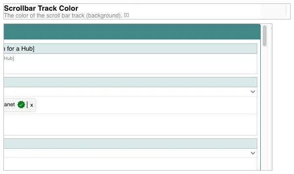

### Scrollbar Thumb Color

The color of the scroll bar thumb (the part you drag) in the Edit Panel. Default: `#c7c7c7`.

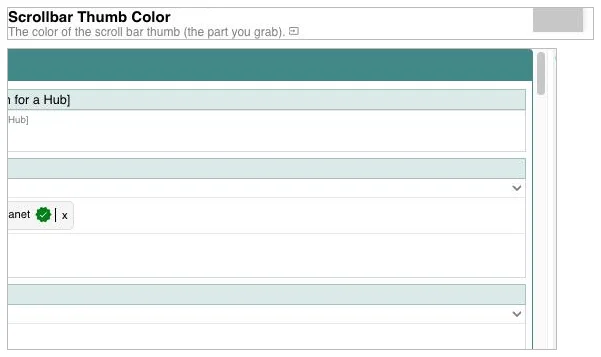

### Hide non-LC Subjects

Hides subject components whose headings are not from a Library of Congress vocabulary. Default: off.

### Hide non-LC class numbers

Hides classification components that are not Library of Congress classification. Default: off.

### Spellcheck

Allows the browser's spell checker to underline misspelled words in literal fields. Default: on.

### Compact View

Lays out fields in columns so that a component takes up fewer lines. Default: off.

### Compact Min Width

With Compact View on, the smallest width in pixels a column can be before the fields stop being arranged in columns. Default: 500. Range: 100 to 1000.

### Placeholder Font Color

The color of the placeholder text shown inside an empty field. Placeholders only appear when [Display field labels](#display-field-labels) is off, since the field label is shown in the field instead. Default: black at half opacity (`#00000080`).

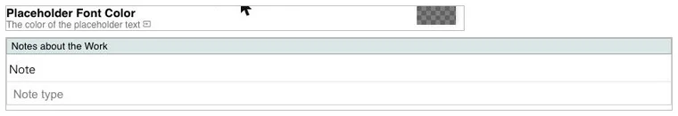

## Sidebars - Property

Options for the Property Sidebar, the panel on the left of the edit screen that lists the components of the record.

### Background Color

The background color of the Property Sidebar. Default: `#2a2a2a` (dark gray).

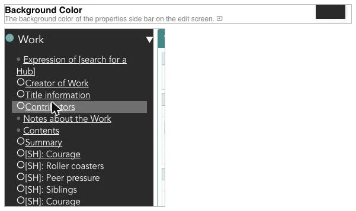

### Highlight Color

The background color of a component name in the Property Sidebar when the mouse is over it. Default: `#6f6f6f`.

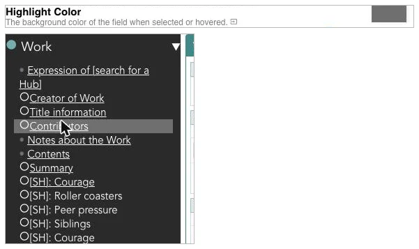

### Sidebar width

The width of the Property Sidebar as a percentage of the window. Default: 5. Range: 5 to 100. At the default width the sidebar shows only the Work and Instance headings; widen it to see the component list.

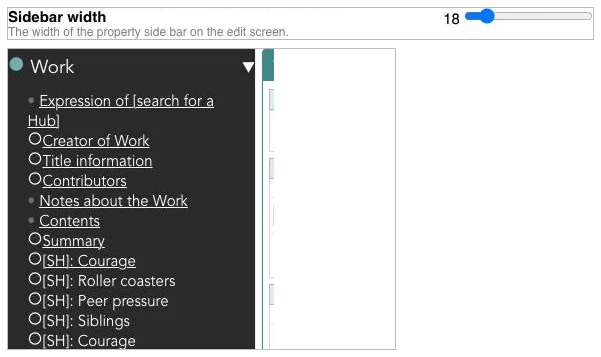

### Font Size

The size of the text in the Property Sidebar, as a multiplier of the base size. Default: 1. Range: 1 to 2.

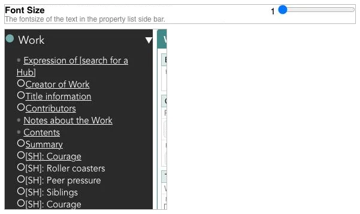

### Font

The font family used for the text in the Property Sidebar. Default: Avenir, Helvetica, Arial, sans-serif.

### Text Color

The color of the text in the Property Sidebar. Default: `#fff` (white).

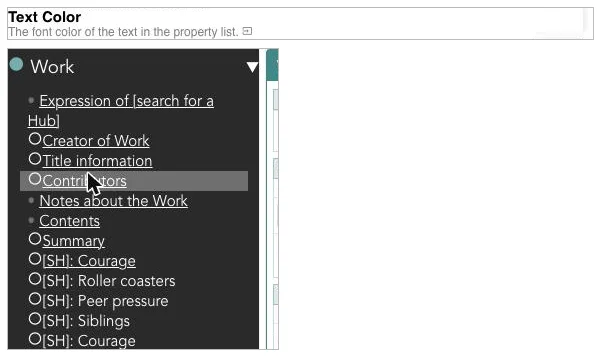

### Empty indicator color

The color of the dot shown next to a component that has no data. Default: `#6f6f6f`.

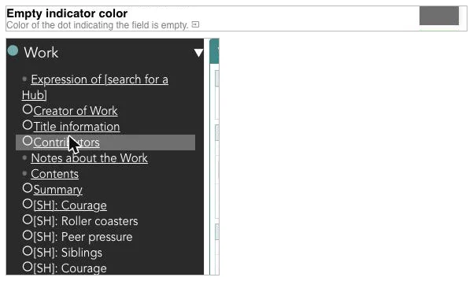

### Populated indicator color

Intended to set the color of the mark next to a component that has data. Default: green. In the current version of Marva this option has no visible effect.

### No Scrollbar

Hides the scroll bar in the Property Sidebar. The list still scrolls with the mouse wheel. Default: on.

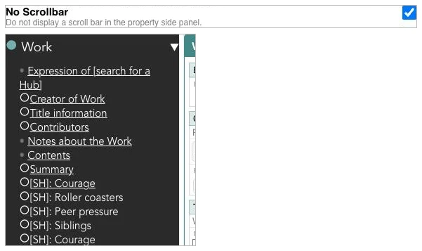

### Type Labels

Shows the type of each value under the component name, for example *Variant Title* under *Title*. Default: off.

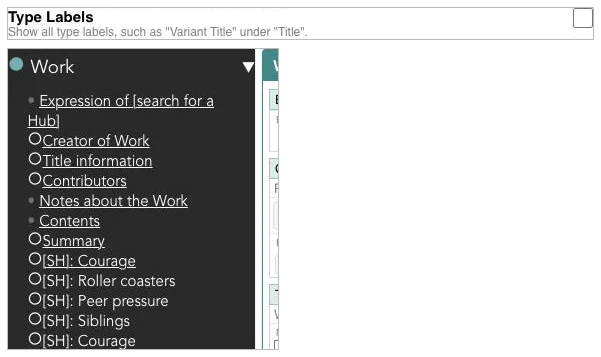

### Number Labels

Adds a number in front of each component name in the Property Sidebar. Default: off.

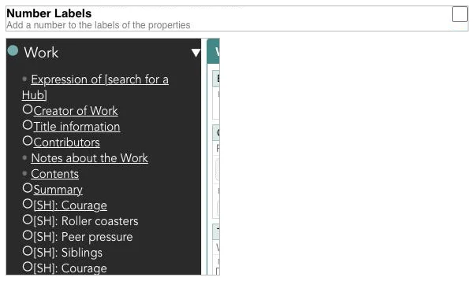

### Accordion List

When on, the Work and Instance sections of the Property Sidebar expand and collapse by clicking their headings. When off, both lists are always expanded. Default: on.

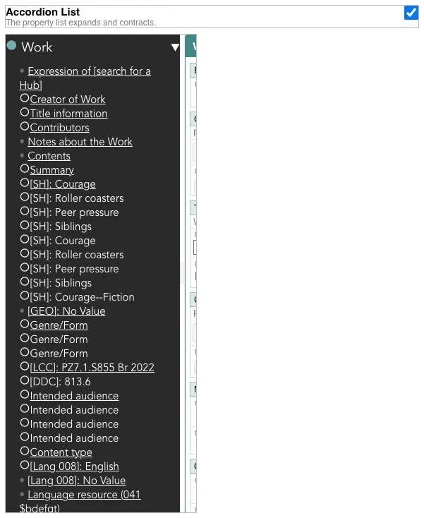

### Component Library

Shows the Component Library tab in the Property Sidebar. See [Using the Component Library](../Marva%20tools/component-library.md). Default: on.

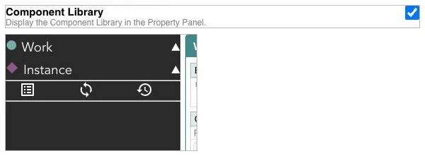

### Prompt to add Library Component

Asks for confirmation before a component from the Component Library is added to the record. Default: on.

### Resize Line Color

The color of the vertical divider lines between the three panels of the edit screen. These lines can be dragged to resize the panels. Default: `#ffffff`.

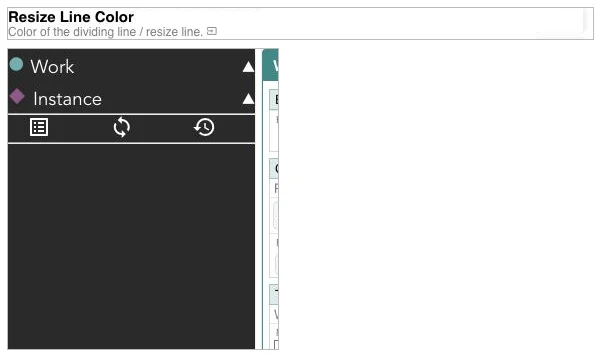

### Resize Line Border Color

The border color of the divider lines between the panels. Default: `#eee`.

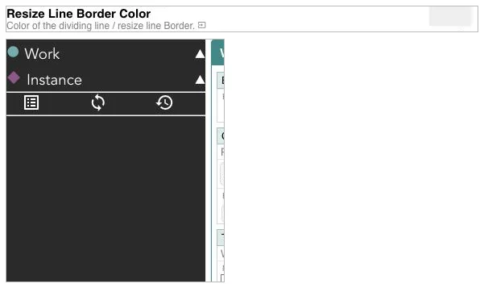

### Default Component Library

Shows the Default Component Library tab in the Property Sidebar, alongside your own Component Library. Default: off.

### Edit Component Library Defaults

Turns on edit mode for the Component Library, so you can choose which default components load with a record and move default components into your own library. Default: off.

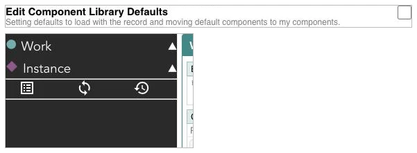

## Sidebars - Previews

Options for the preview panels on the right of the edit screen (the OPAC, MARC, and XML previews chosen from the **View** menu).

### Background Color

The background color of the preview panels. Default: `#f2f2f2`.

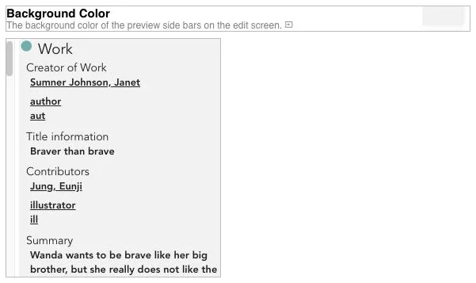

### Highlight Color

Intended to set the background color of a preview entry when the mouse is over it. Default: `#6f6f6f`. In the current version of Marva this option has no visible effect in the OPAC preview.

### Sidebar width

The width of the preview panel as a percentage of the window. Default: 5. Range: 5 to 100.

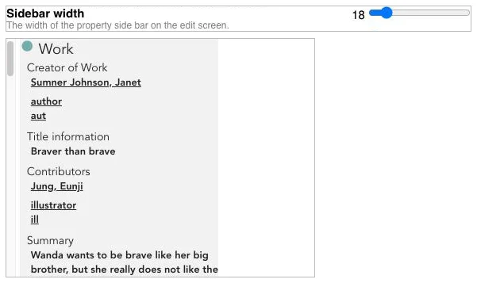

### Font Size

The size of the text in the preview panels, as a multiplier of the base size. Default: 1. Range: 1 to 2.

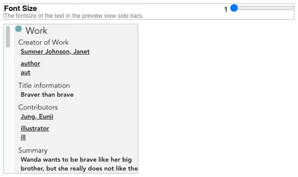

### Font

The font family used in the preview panels. Default: Avenir, Helvetica, Arial, sans-serif.

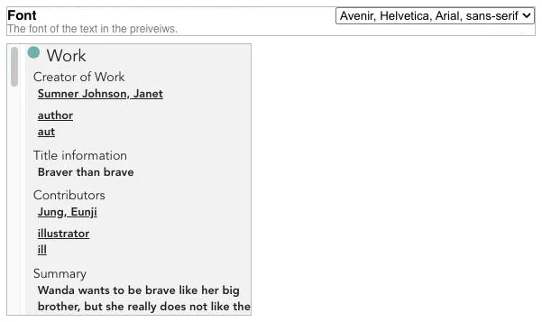

### Text Color

The color of the text in the preview panels. Default: `#202124`.

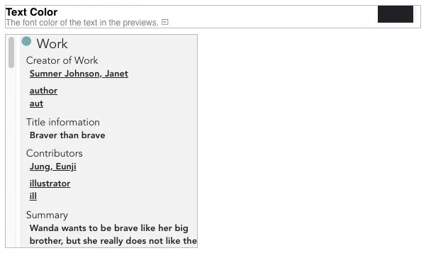

### MARC Boldness

The weight of the text in the MARC preview. Default: 400 (normal). Range: 100 to 1000, where 700 is bold.

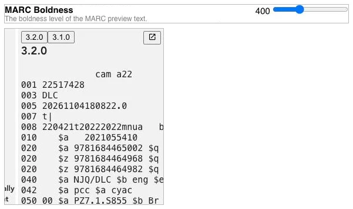

### MARC Font

The font family used in the MARC preview. Default: monospace.

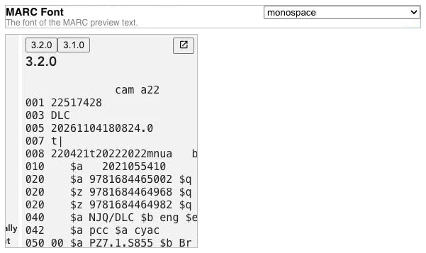

### No Scrollbar

Hides the scroll bar in the preview panels. Default: on.

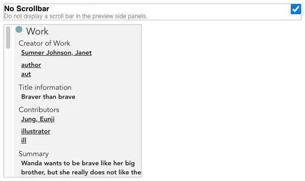

### MARC HTML

Shows the MARC preview as formatted HTML, with each field on its own line and wrapped to the panel width, instead of as plain text. Default: off.

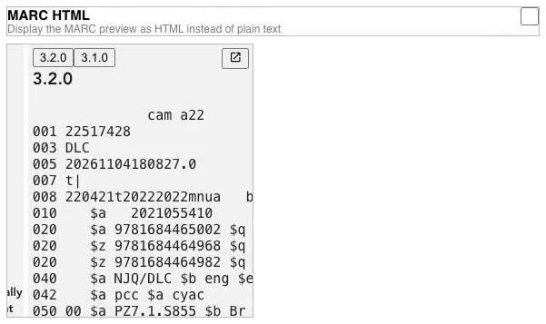

### Subfield Highlight Color

With MARC HTML on, the background color of a subfield in the MARC preview when the mouse is over it. Default: transparent.

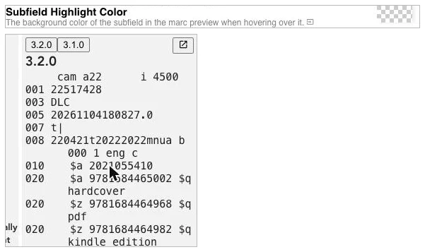

## Nav Bar

Options for the Nav Bar across the top of Marva.

### Height

The height of the Nav Bar in pixels. Default: 35. Range: 5 to 50. Below about 25 the menu text overlaps the panels.

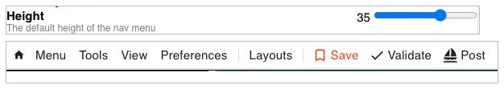

### Font Size

The size of the menu text in the Nav Bar, as a multiplier of the base size. Default: 1. Range: 1 to 2.

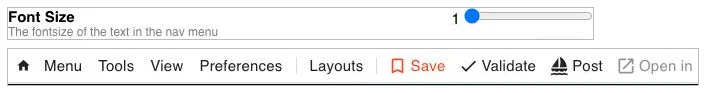

### Background Color

The background color of the Nav Bar. Default: white.

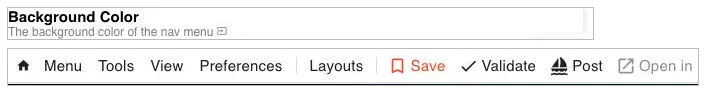

### Text Color

The color of the menu text in the Nav Bar. Default: `#202124`.

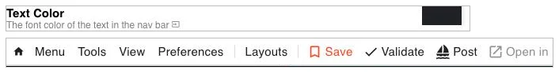

## Literal Field

Options for literal fields, the free-text fields in the Edit Panel such as titles, notes, and summaries.

### Font Size

The size of the text typed into literal fields, as a multiplier of the base size. Default: 1. Range: 1 to 2. At the largest settings the text can be taller than the field and will be clipped.

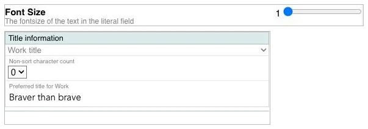

### Font Size Script

The size of non-Latin script text in literal fields, relative to the normal font size. Latin-script text in the same component is not affected. Default: 1. Range: 1 to 2. This is useful when a script is hard to read at the same size as Latin text. Values above about 1.5 can clip the text in a single-line field.

### Font Color

The color of the text in literal fields. Default: black.

### Lang Label Background Color

The background color of the small language indicator that appears at the right of a literal field when the value has a language set. Default: aliceblue.

### Lang Label Font Color

The text color of the language indicator. Default: `#090909`.

### Lang Label Font Size

The size of the language indicator. Default: 1. Range: 1 to 2.

### Make literals bold

Shows the text in literal fields in bold. Default: off.

### Paired literals, show non-Latin First

For paired literals (a value and its transliteration), shows the non-Latin value first. When off, the Latin value is shown first. Default: off.

### Display a line between the two paired literals

Draws a line between the two values of a paired literal to show that they belong together. Default: on.

### Paired literal line color

The color of the line between paired literals. Default: `#4b4b4b`.

### Move components with arrow keys

Lets you use the Up and Down arrow keys to jump between components in the Edit Panel. Default: off.

## Lookup Field

Options for lookup fields, which take values from a controlled vocabulary or authority file and show the chosen value as a badge.

### Lookup value background color

The background color of the badge that shows a chosen lookup value. Default: whitesmoke.

### Lookup value border color

The border color of the lookup value badge. Default: `#dedede`.

### Lookup value text color

The text color of the lookup value badge. Default: black.

### Linked Icon Color

The color of the check mark icon shown on a badge when the value is linked to an authority. Default: green.

### Simple Lookup Popup Background Color

The background color of the list of suggestions that pops up while typing in a simple lookup field such as Relationship designator. Default: white.

### Simple Lookup Popup Text Color

The text color of the suggestion list. Default: black.

### Lookup font size

The size of the text in lookup badges and the suggestion list. Default: 0.75. Range: 0.75 to 2.

### Lookup Shortcode Aliases

Aliases that expand to a lookup value when typed in a simple lookup field. These are edited in their own dialog rather than in the Preferences dialog. See [Shortcode Aliases](shortcodealias.md).

## Action Button

Options for the Action Button, the lightning bolt button that appears at the right of a field when the cursor is in it, and for the menu that opens when it is clicked.

### Action button icon

The name of the Material Icon shown on the button. Default: bolt. Look up icon names at [https://marella.me/material-icons/demo/](https://marella.me/material-icons/demo/).

### Action button color

The color of the icon on the button. Default: `#202124`.

### Action Button background color

The background color of the button. Default: `#fff`.

### Button Icon Size

The size of the icon on the button. Default: 1.25. Range: 1 to 2.

### Button Border Width

The width of the button's border in pixels. Default: 1. Range: 0 to 10.

### Action Border Color

The color of the button's border. Default: `#202124`. The animation uses a border width of 3 so the change is easier to see.

### Button Border Radius

How rounded the corners of the button are, in pixels. Default: 5. Range: 0 to 10.

### Action btn menu color, Icon Size, Action btn menu Border width, Action btn menu border color, Action btn menu Border radius, Action btn menu font color, Action btn menu highlight color

These seven options are left over from an earlier version of the action menu. In the current version of Marva they have no effect. Use the **Menu** options below instead.

### Display Button

Shows the Action Button when the cursor is in a field. When off, the button is hidden. The keyboard shortcuts that open the action menu still work. Default: on.

### Menu background color

The background color of the action menu. Default: white.

### Menu Button Color

The background color of the buttons in the action menu. Default: `rgb(239, 239, 239)`.

### Menu Border Color

The border color of the buttons in the action menu. Default: black.

### Menu Text Color

The text color of the buttons in the action menu. Default: black.

### Button text size

The size of the text in the action menu buttons. Default: 1. Range: 1 to 2.

## Modals

Options for popup dialogs such as the name lookup and subject editor.

### Background Color

The background color of popup dialogs. Default: white.

### Background Accent Color

A second background color used for accents, for example the profile name in the Nav Bar and the cutter tool area in a classification field. Default: whitesmoke.

### Text Color

The text color in popup dialogs. Default: black.

## Complex Lookup

Options for the name lookup dialog and the subject editor (the dialogs that open when you type in a Creator, Contributor, or Subject field).

### Use lookup dropdown

Replaces the row of source buttons at the top of the name lookup dialog (NAF Auth Names, NAF Personal Names, and so on) with a drop-down list. Default: off.

### Show icons in value

Shows an icon next to each piece of a subject heading in the subject editor to indicate its type. Default: on.

### Scroll All Results

Scrolls all result sections of the subject editor together as one list. Default: on.

### Scroll by Section

Scrolls each result section of the subject editor (LCNAF, CYAC, complex headings, and so on) independently. Turn **Scroll All Results** off when using this. Default: off.

### Number of Names

How many names are retrieved for the subject editor. Default: 5. Range: 5 to 100. More results can make searches slower.

### Number of Complex Headings

How many complex (pre-coordinated) headings are retrieved. Default: 5. Range: 5 to 100.

### Number of Simple Headings

How many simple headings are retrieved. Default: 5. Range: 5 to 100.

### Number of CYAC Headings

How many Children's Subject Headings are retrieved when searching Children's Subjects. Default: 5. Range: 5 to 100.

### Include Usage

Shows how many records use each subject heading, next to the heading in the results. This can make searches slower. Default: off.

### Use NAR Advanced Mode by default

Opens the Create NAR dialog in advanced mode. Default: off.

### Number for Fewer/More Buttons

How many results the **Fewer** and **More** buttons in the name lookup dialog add or remove at a time. Default: 10. Range: 0 to 100.

## General

### Work icon color

The color of the Work icon in the Property Sidebar and preview panel. Default: `#7badad`.

### Instance icon color

The color of the Instance icon. Default: `#8b588b`.

### Item icon color

The color of the Item icon. Default: `#eaeaea`.

### Copy mode default

Turns Copy Mode on when Marva starts. Default: off.

### Ad Hoc Mode

Shows only the components that have data or are mandatory, and lets you add other components from the Property Sidebar as needed. This reduces scrolling in the Edit Panel. Default: off.

### Auto Save Mode

Saves the record to the backend after every change. Default: off.

### No field colors in Workflows

Stops the colors set under Field Colors from being applied to the cells of a Workflows sheet. Default: off.

### Default Load Type "Continue"

Sets the load type on the Load screen to *Continue Editing BF* instead of *Reconvert from MARC*. Reconverting ensures the record has gone through the latest MARC to BIBFRAME conversion. Default: off.

### Load with Default Values

Adds the profile's default values to every component when an existing record is loaded, the same as pressing *Add All Defaults* in the Property Sidebar. Normally defaults are only added to new records. Only empty fields are filled, so a record that already has a value keeps it. Default: off.

In the example below the record has no classification or audience source. With the option on, Assigning agency, Used by assigning agency and Source are filled in on load.

## Shelflisting

Options for the cutter and shelflisting tools shown in the Classification numbers component.

### Display cutter tools

Shows the Cutter Calculator and shelflisting links in the Classification numbers component. The tools only appear when the record has a creator or title. Default: on.

### Cutter Length

The starting number of characters for the Cutter Calculator. Default: 3. Range: 1 to 6. The calculator's own slider changes the length for the current record only.

### Shelf List Accent

The background color of every other row in the shelf list search results. Default: `#f1f7ff`.

### ClassWeb Links Inline

Shows the ClassWeb links to the right of the Cutter Calculator instead of above it. Default: off.

### Link 1 to Link 8 Label and URL

Up to eight links to outside resources shown next to the Cutter Calculator. Each link has a label and a URL. The first three are set by default to the Cutter Table, the Biography Table, and the Translation Table. Leave a label blank to hide that link.

### MLC Division

A division value to insert automatically after the MLCX part of an MLC number. Default: blank. See [MLC Numbers](../Marva%20tools/mlc-numbers.md).

### Load with Classification Defaults

Adds the default values of the LC Classification template, Assigning agency and Used by assigning agency, to the Classification numbers component when an existing record is loaded. No other component is changed. Not needed when [Load with Default Values](#load-with-default-values) is on, since that already adds every default. Default: off.

## Scriptshifter

### Capitalize the first letter

Capitalizes the first letter of text transliterated by ScriptShifter. Default: off. See [Appendix C: ScriptShifter](c-scriptshifter.md).

## Copy Cat

Options for the Copy Cat search screen.

### Copy Cat color

The background color of the panels on the Copy Cat screen. Default: `#d7d7d7`.

### Text Color

The color of the text on the Copy Cat screen. Default: black.

### Results Color

The background color of each search result card. Default: white.

### Selected Color

The background color of the selected result card. Default: antiquewhite.

### MARC Hover

The background color of a subfield in a result's MARC view when the mouse is over it. Default: transparent.

### Existing Color

When comparing a Copy Cat record with an existing record, the background color of the existing record. Default: `#fafad2`.

### New Color

When comparing, the background color of the new record. Default: `#e3ffd8`.

### Font Size

The size of the text on the Copy Cat screen. Default: 1. Range: 1 to 2.

### NonLatin Default

Checks the *non-Latin script* box on the Copy Cat screen by default. Default: off.

### Priority Default

The default value for the Priority field on the Copy Cat screen. Default: 3.

## Other preferences

A few preferences are managed outside the Preferences dialog:

- **Diacritic Macros** and **Text Macros** have their own dialogs under the Preferences menu in the Nav Bar.
- **Field Colors** are set from the Field Colors dialog in the Preferences menu. See [The Preferences menu](#the-preferences-menu).
- **Layouts** are saved from the Layouts menu. See [Layouts](layouts.md).
- **Default profile**, used when pressing Enter on the Load screen, is set from the drop-down at the bottom of the Load screen.

---

[Back to Table of Contents](../index.md)
