# Workflows

Workflows is a spreadsheet for working through many records at once. Each record is a row, a chosen set of fields are the columns, and records are added by scanning a barcode or typing an identifier. The cells are the same fields the Marva editor has, so lookups, the action menu and your preferences work the same way.

A **workflow** is a saved list of fields (for example *Monograph: CIP Verification*). A **sheet** is one sitting with a workflow: the records you loaded into it. You can have as many sheets as you like and come back to any of them.

## Contents

- [Opening Workflows](#opening-workflows)
- [The Workflows screen](#the-workflows-screen)
- [Starting a sheet](#starting-a-sheet)
- [Adding records](#adding-records)
- [The sheet](#the-sheet)
- [Editing cells](#editing-cells)
- [Copy and paste](#copy-and-paste)
- [The record's buttons](#the-records-buttons)
- [Choosing the fields](#choosing-the-fields)
- [Options and the one-record-per-page layout](#options-and-the-one-record-per-page-layout)
- [Saving and coming back to a sheet](#saving-and-coming-back-to-a-sheet)
- [CIP Verification](#cip-verification)
- [Making your own workflow](#making-your-own-workflow)
<!-- - [Advanced: the graph builder](#advanced-the-graph-builder) -->
- [Mouse and keyboard reference](#mouse-and-keyboard-reference)

## Opening Workflows

On the Marva load screen click **Open Workflows**.

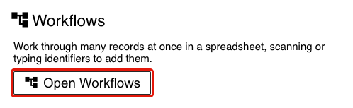

## The Workflows screen

The left side lists the workflows, the right side (**Continue**) lists the sheets you have opened before.

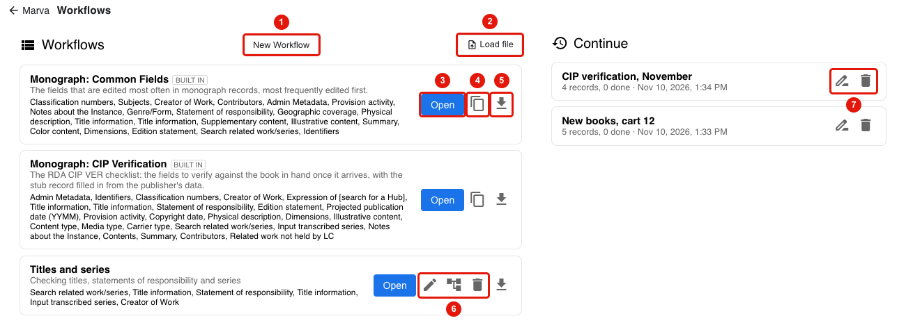

1. **New Workflow** makes a workflow of your own. See [Making your own workflow](#making-your-own-workflow).
2. **Load file** loads a workflow that someone saved as a file.
3. **Open** starts a new, empty sheet with that workflow.
4. The copy icon on a built-in workflow makes your own copy of it to change.
5. The download icon saves the workflow as a file you can send to a colleague.
6. On a workflow you made: edit it<!--, edit it as a graph,--> or delete it.
7. On a sheet under Continue: rename it or delete it. Deleting a sheet does not delete its records. Click the sheet's name to open it.

Two workflows are built in:

- **Monograph: Common Fields** has the fields that are edited most often in monograph records, most frequently edited first.
- **Monograph: CIP Verification** has the fields of the RDA CIP verification checklist and compares each record with WorldCat. See [CIP Verification](#cip-verification).

## Starting a sheet

Click **Open** on a workflow, give the sheet a name you will recognize later, and click **Open**. The name can be changed afterwards by clicking it at the top of the sheet.

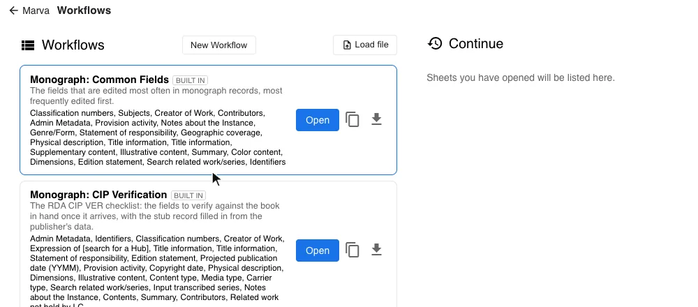

## Adding records

Records are added through the scan box at the top of the sheet.

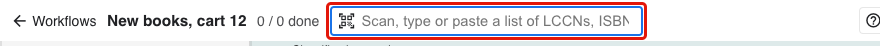

- **Scan** a barcode (LCCN, ISBN or item barcode) at any time. The cursor does not need to be in the scan box, and a scan made while a cell is open still goes to the scan box.
- **Type** an LCCN, ISBN or barcode in the box and press Enter.
- **Paste a list** of identifiers into the box, one per line or separated by spaces or commas. They are all looked up and added in the order of the list.

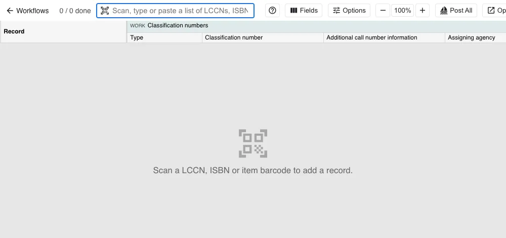

A message at the bottom right says how many were found. An identifier with no match gets its own message in the middle of the screen. Scanning a record that is already on the sheet flashes its row instead of adding it twice.

### When a scan matches several records

A book often has a print record and an ebook record that list each other's ISBN. When you scan an ISBN and only one of the records has it as its own, valid ISBN, that record is taken and a message says so (for example *Took the print record for "9780593318171": "9780593318171" is canceled in the ebook record*).

When Marva cannot tell, it asks:

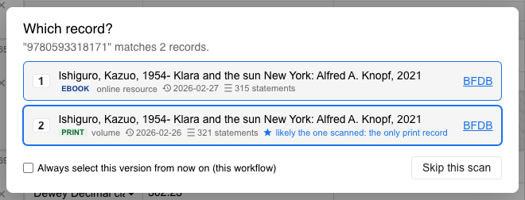

Each choice shows whether it is print or ebook, when it was last changed and how much data it has. The starred one is the likely match, with the reason. Click a choice or press its number. **Skip this scan** (or Esc) adds nothing.

Check **Always select this version from now on** to stop being asked in this workflow. To be asked again, open **Options** and click **Ask me which record each time**.

## The sheet

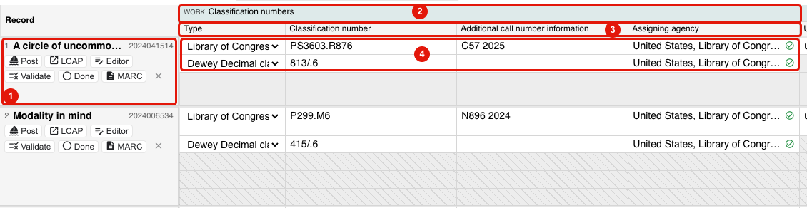

1. The **Record** column says which record the row is: its number, title and LCCN, with the record's buttons underneath. It stays in place when you move sideways. Click the title or the LCCN to copy it.
2. A band for each field, marked WORK or INSTANCE and colored the same way as in the editor. The eye icon at the right end of a band hides that field.
3. The columns of the field. A field with several parts (a class number with its type, number, assigning agency...) has a column for each.
4. The record's values. A field the record has more than once (two class numbers, five subjects) takes one line each.

Gray cells are not part of the record: a line the record does not have, or a column that does not apply to that line (the Dewey edition number on a Library of Congress class number, for example). Every other record has its gray cells hatched, which makes it easier to see where one record ends and the next begins.

The bar at the top of the sheet:

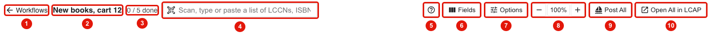

1. Back to the Workflows screen.
2. The sheet's name. Click to rename.
3. How many records are marked Done.
4. The scan box.
5. Help: the mouse and keyboard reference.
6. **Fields**: which fields the sheet shows. See [Choosing the fields](#choosing-the-fields).
7. **Options**: layout and preferences.
8. Zoom out, reset the view, zoom in.
9. **Post All** posts every record that has not been posted yet, after asking you to confirm. It stops at the first record that fails.
10. **Open All in LCAP** opens every record in LCAP, each in its own tab.

### Moving around

- Drag an empty part of the sheet to move it, or use the mouse wheel.
- Ctrl (or ⌘) + wheel zooms. So do the − and + buttons.
- Drag the edge of a column header to resize the column. Double-click the edge to reset it. Widths are remembered for that kind of column on every sheet.

## Editing cells

Click a cell to select it (blue outline). Click it again, press Enter or F2, or just start typing to edit it. Press Enter or Esc when you are done.

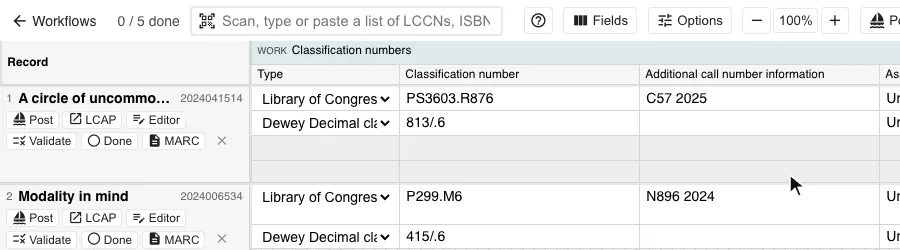

The pencil icon next to the record's title means the record has changes that are not saved yet. It is saved automatically a few seconds after you stop.

A field with a list of values works as it does in the editor: type, pick from the list with the arrow keys, press Enter.

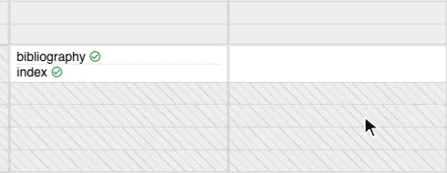

- Opening a cell that holds a name, subject or other linked heading opens the search window for it, as in the editor.
- Typing on a selected cell that already has text adds to the text. It does not replace it.
- **Delete** or **Backspace** on a selected cell clears it.
- **Ctrl/⌘ + Z** undoes the last change to a record. **Shift + Ctrl/⌘ + Z** redoes it. This works when no cell is open.

### The action menu

Right-click a cell for the same action menu the field has in the editor. Use **Add Another Component** to give the record another line of that field (another class number, another note), and **Delete Component** to remove one.

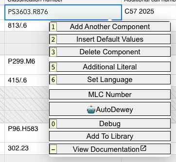

## Copy and paste

Select a cell and press **Ctrl/⌘ + C**. The cell gets a moving dashed outline. Select another cell of the same kind and press **Ctrl/⌘ + V**. The value is pasted with its link, not just its text, so a linked name or subject stays linked. Esc stops copying.

- Pasting on a gray line under a field adds the value to the record as a new line.
- A value can only be pasted into a field of the same kind. If it cannot go there a message says why.
- The copied text is also on your computer's clipboard, so it can be pasted into another program.

### Pasting down a column

To give every record the same value: copy a cell, click the column's header to select the whole column, and paste.

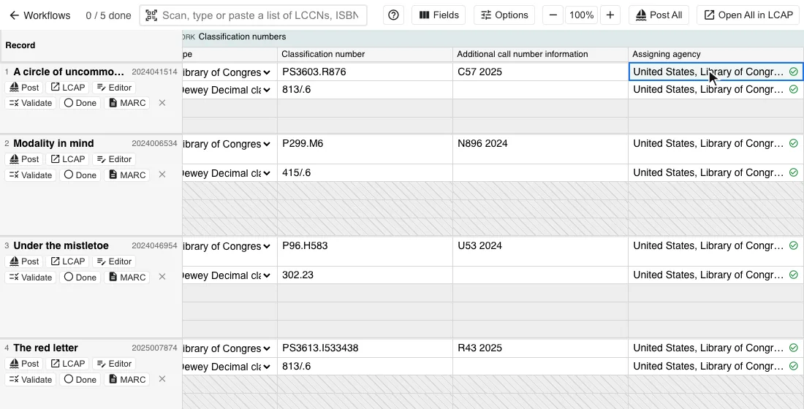

Choose what should happen:

- **Overwrite the values** replaces the cells that have a value and leaves the empty ones empty.
- **Overwrite if present, otherwise add** gives every record the pasted value.
- **Add alongside the existing values** puts the pasted value next to what is there.
- **As a new component** gives every record another line of the field holding the pasted value. Pick the type of the new line at the bottom of the dialog.

Pasting down a column is one step to undo.

## The record's buttons

The buttons under a record's title:

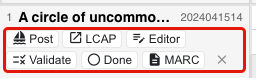

| Button | What it does |
|---|---|
| **Post** | Posts the record, the same as Post in the editor. The icon changes once it has been posted. |
| **LCAP** | Opens the record in LCAP. |
| **Editor** | Saves the record and opens it in the full Marva editor in a new tab. |
| **Validate** | Checks the record with the validation service. The result shows under the record's title. Click it to see the messages, and click a message to jump to the field it is about. |
| **Done** | Marks the record as done. Done records are grayed and counted at the top of the sheet. Editing a record again takes the mark off. |
| **MARC** | Hold the mouse over it to see the record as MARC. |
| **×** | Takes the record off the sheet. The record itself is not deleted. |

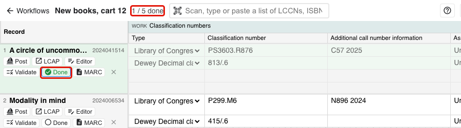

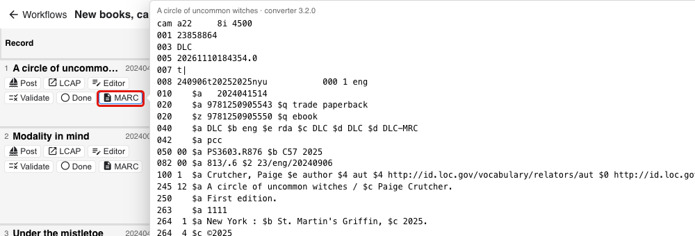

## Choosing the fields

Click **Fields** to choose what the sheet shows.

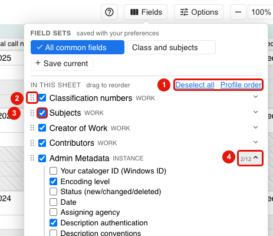

1. **Deselect all / Select all** unchecks or checks every field in the list. **Profile order** puts the fields in the order they have in the profile, which is the order of the editor.
2. Drag the handle to move a field. The order of the list is the order of the columns.
3. Uncheck a field to hide it. It stays in the list so it can be shown again.
4. A field with several parts has an arrow. Open it to choose which parts get a column. The small number says how many are shown (*2/12*).

### Adding a field

The bottom of the menu lists the rest of the profile's fields. Type in the filter box to find one, and click a field to add it to the end of the sheet. **Add all** adds every Work or Instance field that is listed.

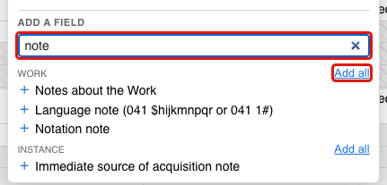

The sheet remembers your fields. The next sheet you start with the same workflow opens with the fields you last had.

### Field sets

A field set is a named selection of fields that you can switch to with one click. Arrange the fields the way you want them, click **Save these fields as a set** (or **Save current**) at the top of the Fields menu, and give it a name. The sets show as buttons at the top of the menu. The one the sheet is showing has a check mark.

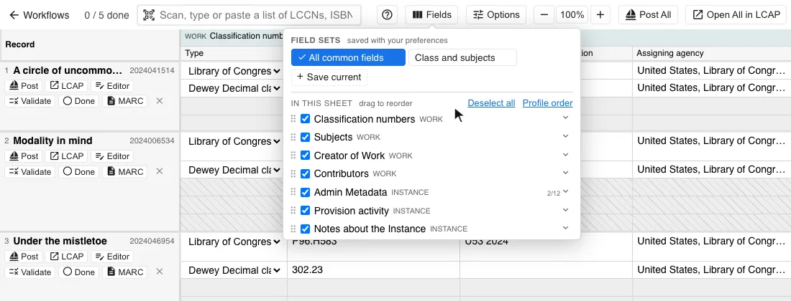

Hover over a set and click its × to delete it. Field sets are kept with your Marva preferences, so **Save to DB** in the Preferences menu carries them to another computer.

## Options and the one-record-per-page layout

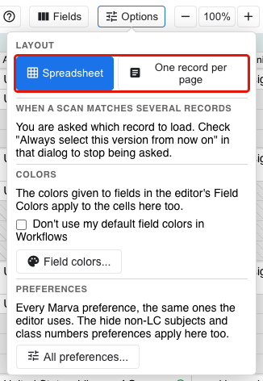

- **Layout** switches between the spreadsheet and one record per page.
- **When a scan matches several records** shows whether you are asked, and lets you go back to being asked.
- **Colors**: the Field Colors you set in the editor color the cells here too. Check *Don't use my default field colors in Workflows* to turn that off, or click **Field colors...** to change them.
- **All preferences...** opens the Marva Preferences dialog. The *Hide non-LC subjects* and *Hide non-LC class numbers* preferences apply to the sheet. When headings are hidden a note under the field says how many, with **Show** to see them for that record.

### One record per page

In this layout one record fills the page and its fields are stacked down it, which suits records that are checked one at a time.

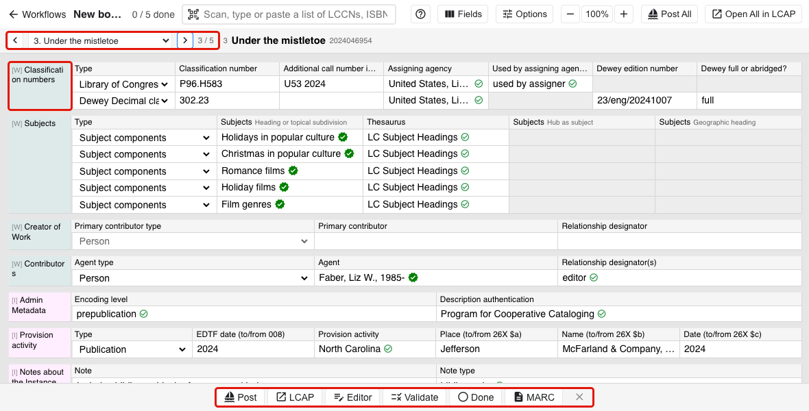

- Top left: previous and next record, a list to jump to any record, and the record's place in the sheet.
- Left column: the name of each field.
- Bottom: the record's buttons.

**W / S** or **Page Up / Page Down** turn to the previous or next record. A scan adds the record to the end of the list and leaves you on the record you are working on.

## Saving and coming back to a sheet

- A record is saved automatically a few seconds after you change it, and when you move to another record. Records you only looked at are not saved.
- Records changed on a sheet are ordinary Marva records. They appear under your records on the load screen and can be opened in the editor.
- The sheet itself (which records are on it, which are done or posted) is saved to your Marva account. Open it again from **Continue** on the Workflows screen, from any computer.
- A sheet reopens on the record you were last working on (on the same computer).

## Special Predefined Workflows -- CIP Verification

**Monograph: CIP Verification** is for verifying a CIP record against the book in hand. Its fields follow the RDA CIP verification checklist, in the checklist's order. For each record it looks the book up in WorldCat and compares the two, field by field.

Scan the book's ISBN or item barcode, or its LCCN. The lookup uses what you scanned, or the record's ISBN and LCCN.

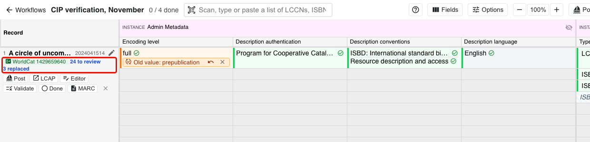

### Under the record's title

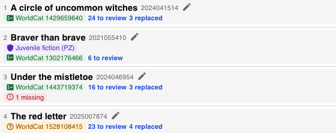

- **WorldCat** and a number: the WorldCat record that was found. Click it to open the record in WorldCat. A green icon means its LCCN matches the record. An amber question mark (fourth record above) means the match was made on the ISBN only, so check that it is the right book.
- **N to review**: suggestions waiting for you to accept or dismiss. When there are none it says how many fields match.
- **N replaced**: fields that were filled in or corrected from WorldCat automatically.
- **N missing**: required fields that are empty.
- A purple shield (second record above): the record is protected. See [Protected records](#protected-records).
- **Not in WorldCat** or **WorldCat lookup failed** (with **Try again**) when there is nothing to compare with.

### What the cells show

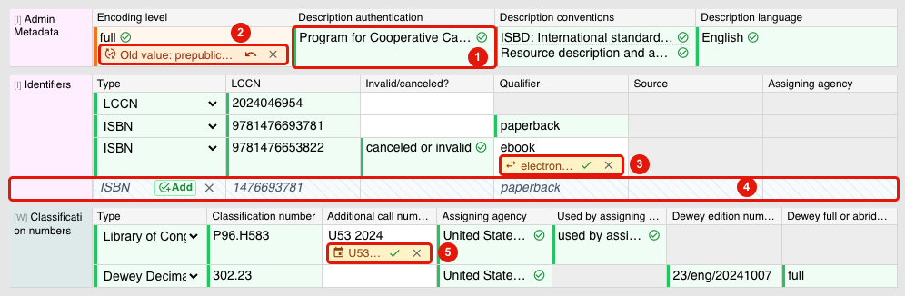

1. **Green** cell: the record and WorldCat agree. Nothing to do.
2. **Orange** note under a value: the value was taken from WorldCat automatically. The note says what was there before (*Old value: prepublication*, or *Was empty*). The ↶ arrow puts the old value back. The × hides the note.
3. **Amber** suggestion under a value: WorldCat has something different. Click ✓ to replace the record's value with it, or × to keep what the record has.
4. A whole line in italics with **Add**: something WorldCat has and the record does not. Click **Add** to put it in the record, or × to dismiss it.
5. A suggestion from the checklist itself. Here the year at the end of the call number does not match the publication date. Click ✓ to correct it.

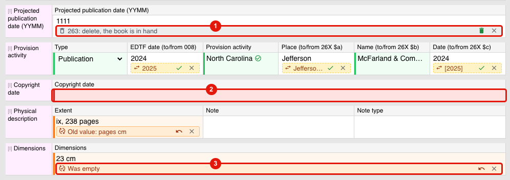

1. The projected publication date (263) is offered for deletion because the book is in hand. Click the trash icon to delete it.
2. **Red** cell: a required field is empty.
3. A field that was empty and was filled in from WorldCat.

Clicking **Add** on a suggested line:

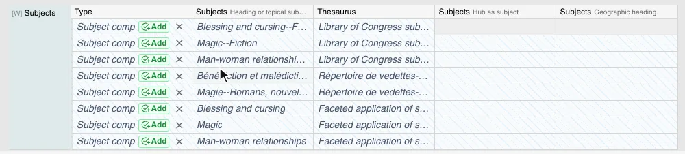

Names and headings taken from WorldCat come in as text, not linked (the yellow icon). LC does not use WorldCat's identifiers. Link them to the authority file the usual way, by opening the cell.

Nothing is changed in the record unless you click, except what is listed under *Filled in automatically* below. Every change, automatic or not, can be undone with Ctrl/⌘ + Z.

### Filled in automatically

When the WorldCat record comes back these fields take WorldCat's value without a click, each with an orange note:

- Admin Metadata (encoding level, description authentication, description conventions, description language)
- Statement of responsibility
- Copyright date
- Physical description (extent)
- Dimensions
- Illustrative content

The checklist's fixed values are also set: encoding level *full*, description conventions ISBD and RDA, description language English, description authentication *pcc*, and abbreviations in the physical description spelled out (*p.* to *pages*, *ill.* to *illustrations*, and so on).

Two more things happen when a record is loaded:

- When the physical description says the illustrations are in color and the record has no color content, color content is set to *color*.
- A subject heading that is linked to LCSH or to the Children's Subject Headings but has no thesaurus gets the matching thesaurus.

A linked value is never replaced by WorldCat's unlinked text. Those stay as suggestions.

### Checked but left to you

- **Call number**: the year ending the call number should be the publication year.
- **ISBNs**: an ebook ISBN that is still marked valid is offered to be marked canceled/invalid.
- **Projected publication date**: offered for deletion.
- **Content, media and carrier type** other than text, unmediated, volume get a warning to look at.

### Required fields

Statement of responsibility, copyright date, physical description and dimensions are marked red when they are empty. The red marks and the *missing* count go away when the record is marked Done.

### Fields added to the sheet

If WorldCat has values for a field that is not on the sheet (subjects, genre/form, intended audience...), the field is added to the end of the sheet and a message says so.

Nothing from WorldCat is offered for *Search related work/series* or *Expression of*. Series statements are compared under *Input transcribed series*.

### Protected records

For some records WorldCat's data is never offered as a replacement, only as additions:

- **Juvenile fiction classed in PZ**: the summary, subjects, genre/forms and classification.
- **Law classed in K**: the subjects, genre/forms and classification.

Where WorldCat differs, a red note says *Not replaced* and what WorldCat has. Lines WorldCat has and the record does not can still be added.

## Making your own workflow

Click **New Workflow** on the Workflows screen, or the copy icon on a built-in workflow to start from it.

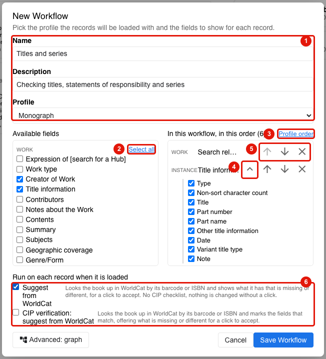

1. Give the workflow a name, an optional description, and pick the profile its records are loaded with.
2. Check the fields to include. **Select all** checks every Work or every Instance field.
3. The fields you checked, in the order they will be on the sheet. **Profile order** sorts them into the order of the profile.
4. Open a field to choose which of its parts get a column.
5. Move a field up or down, or remove it.
6. What to run on each record as it is loaded:
   - **Suggest from WorldCat** compares each record with WorldCat and offers what is missing or different, as described under [What the cells show](#what-the-cells-show). Nothing is changed without a click, and none of the CIP checklist's rules apply.
   - **CIP verification** is the full CIP comparison, with the automatic steps described above.

<!-- 7. **Advanced: graph** opens the graph builder. -->

Click **Save Workflow**. The workflow appears on the Workflows screen with **Open**, and icons to edit, <!--edit as a graph, -->delete and save as a file.

Changing the fields of a sheet from its Fields menu does not change the workflow itself. It changes what your own sheets of that workflow show.

<!-- The graph builder is left out of the manual for now.

## Advanced: the graph builder

A workflow can also carry a set of rules that run on each record as it is loaded, before it goes on the sheet. The rules are drawn as a graph: boxes (nodes) joined by wires. A workflow with a graph has a **Graph** tag on the Workflows screen.

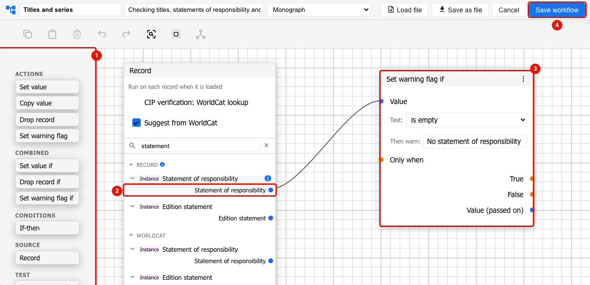

1. The nodes. Drag one onto the canvas.
2. The **Record** node lists the record's fields. Use *Find a field* to find one, open it, and drag from the dot beside it to a dot on a node. When a WorldCat option is checked on the Record node, WorldCat's fields are listed too.
3. A node. This one tests whether the statement of responsibility is empty and, when it is, flags the record with a warning.
4. **Save workflow** when you are done. **Save as file** and **Load file** move a workflow, graph included, between people.

The nodes:

| Node | What it does |
|---|---|
| **If-then** | Tests a value: is empty, is not empty, equals, does not equal, contains, starts with, matches a pattern, or is a number less or greater than. It can compare with another field or with text you type, and can compare as years. Its True and False outputs go to the *Only when* dot of other nodes. |
| **Set value** | Puts a value in a field: a value from a wire, or text or a linked value typed on the node. It can write only if the field is empty, replace what is there, or add to it. |
| **Copy value** | Copies a value into a field, for example a WorldCat value into the record. |
| **Transform** | Changes a text before it is written: trim spaces, replace by pattern, add before or after, change case, strip ending punctuation. |
| **Drop record** | Keeps the record off the sheet, with a reason. |
| **Set warning flag** | Shows a warning under the record's title. The record is not changed. |
| **Set value if, Drop record if, Set warning flag if** | A test and an action in one node, for the common case of one test and one action. |
| **Test on a record** | Runs the graph on one record you scan or type, inside the builder, and lists what it would change. Nothing is saved. |

A node runs once for each line of the field it is wired to: once per contributor, once per subject.

On the sheet, what the graph did to a record is listed under its title, with a button to run it again. Records the graph dropped are listed at the bottom of the sheet (*N records dropped by the workflow*), each with its reason and **Load anyway**.

-->

## Mouse and keyboard reference

The **?** button at the top of the sheet shows this list.

### Mouse

| | |
|---|---|
| Click | select a cell, click it again to edit |
| Right click | the field's action menu |
| Paste in the scan box | a list of identifiers adds them all |
| Drag | move around the sheet |
| Ctrl / ⌘ + wheel | zoom |
| Column edge | drag to resize, double click to reset |
| Column header | select the column, then paste a copied cell down it |

### Keyboard, with a cell selected

| | |
|---|---|
| Arrows, Tab | move one cell |
| A / D | previous / next field |
| W / S | previous / next record |
| Home / End | start / end of the row |
| Page Up / Page Down | 10 lines (in the one-record-per-page layout: previous / next record) |
| Ctrl + Home / End | first / last cell of the sheet |
| Enter, F2, typing | edit the cell |
| Enter / Esc | finish editing |
| Delete, Backspace | clear the cell |
| Ctrl / ⌘ + C | copy the cell |
| Ctrl / ⌘ + V | paste the copied cell here, or on a gray line below a field as a new line |
| Ctrl / ⌘ + Z | undo the last change to a record (Shift to redo) |
| Esc | stop copying, deselect |
