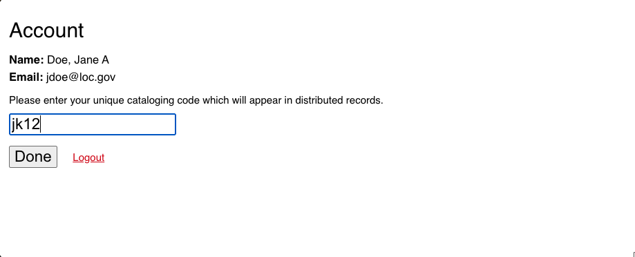

# Accessing Marva

Using Chrome enter [https://editor.id.loc.gov/marva](https://editor.id.loc.gov/marva)

## LC SSO Access

At LC we have Single Sign-On (SSO) which will automatically log you into Marva. The only information you need to provide before you get started is the Cataloger ID.
You will see this pop-up asking for your code. Use your cataloger code that you add in the MARC 955 field of records you work on.

## Getting Started in Marva

See [Configuration](Configuration/index.md) for information about customizing display preferences in Marva.
See [Load description from LCAP for editing](https://bibframe.org/docs/view/documentation-marva-manual/Create%20and%20Edit%20Descriptions/load-records.md#load-description-from-lcap-for-editing) for information about editing descriptions in Marva.

---

[Back to Table of Contents](index.md)
